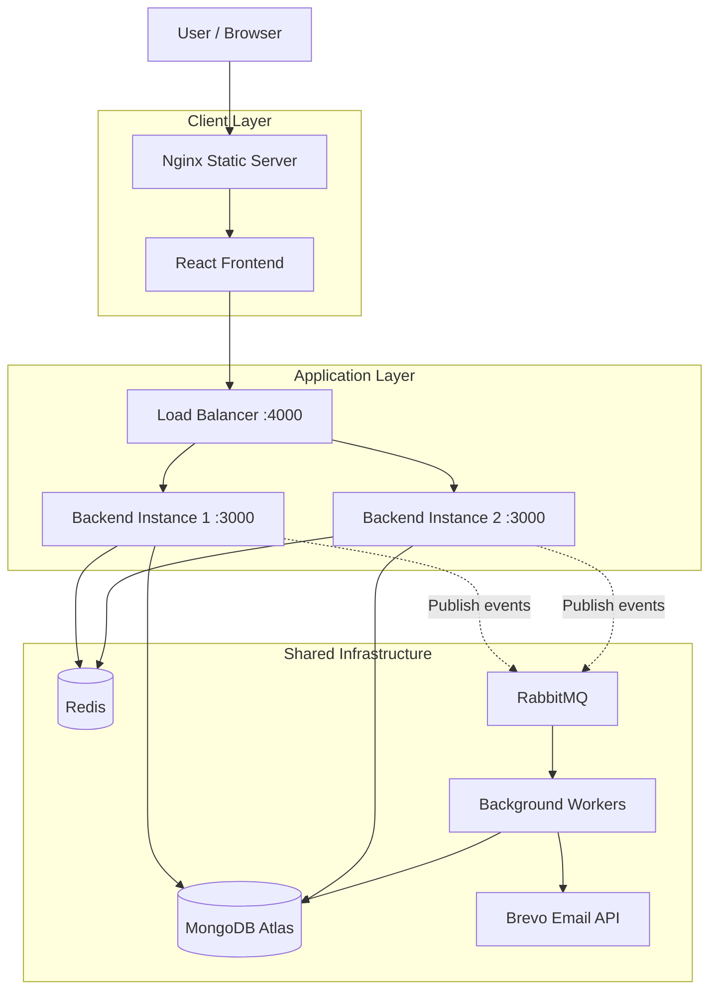
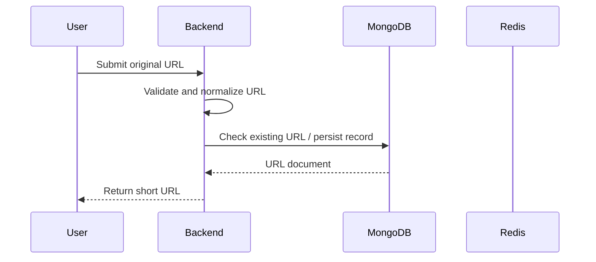
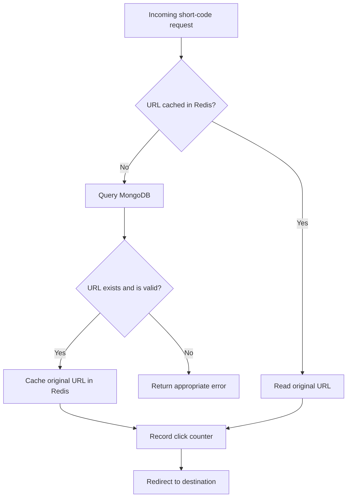
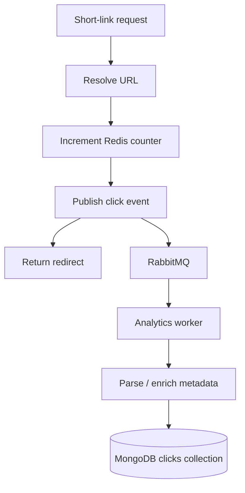

# WhyLong — System Architecture

> **WhyLong** is a link management platform that provides URL shortening, click analytics, and customizable QR code generation. Its architecture combines a React frontend, Node.js backend services, Redis caching, RabbitMQ-based asynchronous processing, MongoDB persistence, and a custom load balancer.

---

## Table of Contents

1. [Architecture Overview](#1-architecture-overview)
2. [Technology Stack](#2-technology-stack)
3. [High-Level Architecture](#3-high-level-architecture)
4. [System Components](#4-system-components)
5. [Request Lifecycle](#5-request-lifecycle)
6. [URL Shortening and Redirection](#6-url-shortening-and-redirection)
7. [Caching and Click Counting](#7-caching-and-click-counting)
8. [Analytics Architecture](#8-analytics-architecture)
9. [Asynchronous Processing with RabbitMQ](#9-asynchronous-processing-with-rabbitmq)
10. [Data Model and Persistence](#10-data-model-and-persistence)
11. [Load Balancing and Horizontal Scaling](#11-load-balancing-and-horizontal-scaling)
12. [Containerization and Deployment](#12-containerization-and-deployment)
13. [Security Architecture](#13-security-architecture)
14. [Failure Handling and Reliability](#14-failure-handling-and-reliability)
15. [Performance Considerations](#15-performance-considerations)
16. [Architectural Trade-offs](#16-architectural-trade-offs)
17. [Current Limitations and Future Evolution](#17-current-limitations-and-future-evolution)

---

## 1. Architecture Overview

WhyLong follows a **modular backend architecture with separately deployable frontend and backend components**.

The application is organized around clear responsibilities:

- The frontend handles user interaction and presentation.
- The load balancer distributes incoming API requests across backend instances.
- Backend services implement business logic, authentication, URL management, and redirects.
- MongoDB persists application data.
- Redis supports low-latency URL caching and click counting.
- RabbitMQ provides asynchronous messaging between producers and consumers.
- Worker processes perform background tasks independently of request-handling processes.

The objective is to separate responsibilities without introducing unnecessary distributed-system complexity.

WhyLong uses multiple backend instances to explore horizontal scaling while retaining shared infrastructure for persistence, caching, and messaging.

### Architectural principles

- **Separation of concerns:** Each component has a clearly defined responsibility.
- **Stateless API instances:** Application instances should not depend on process-local session state.
- **Shared infrastructure:** Backend instances use common Redis, RabbitMQ, and MongoDB resources.
- **Asynchronous processing:** Suitable background operations should not unnecessarily delay user-facing requests.
- **Observability:** Requests, errors, queue health, and application performance should be measurable.
- **Progressive complexity:** Introduce additional infrastructure only when it solves a concrete problem.

---

## 2. Technology Stack

| Layer | Technology | Responsibility |
|---|---|---|
| Frontend | React, Vite, Tailwind CSS | User interface and client-side routing |
| Backend | Node.js, Express.js | API endpoints and business logic |
| Database | MongoDB, Mongoose | Persistent application data |
| Cache | Redis | Cached URL resolution and click counters |
| Message broker | RabbitMQ | Asynchronous event delivery |
| Background processing | Node.js worker processes | Email and other background jobs |
| Load balancing | Custom Node.js/Express service | Distributing requests between backend instances |
| Containerization | Docker, Docker Compose | Reproducible application environments |
| Reverse proxy / static server | Nginx | Serving the production frontend |
| CI/CD | GitHub Actions | Automated checks and container builds |
| Email delivery | Brevo API | Transactional emails |

MongoDB Atlas is the external database provider in the current deployment setup. The other infrastructure components can run as Docker services.

---

## 3. High-Level Architecture



**Important:** The diagram represents the overall architecture and intended integration boundaries. Not every analytics operation is necessarily asynchronous in the current implementation. Existing request paths should be documented according to their actual code.

### Network boundaries

The browser communicates with the public frontend and the load balancer.

The load balancer communicates with backend instances over the Docker network. Backend services communicate with Redis and RabbitMQ through their internal service names.

MongoDB Atlas is reached through its configured external connection URI.

The browser must never connect directly to Redis, RabbitMQ, or MongoDB.

---

## 4. System Components

### 4.1 Frontend

The React application provides:

- Public landing pages.
- URL shortening.
- User authentication.
- Link management.
- Click analytics dashboards.
- QR code generation and customization.
- Account settings and security-related workflows.

The frontend calls the backend API through a configured API base URL.

Authentication uses cookie-based credentials. Requests that require the session must include credentials where applicable.

The frontend is responsible for presentation and client-side validation. The backend remains responsible for authorization, business rules, and input validation.

### 4.2 Load balancer

The custom load balancer accepts requests and forwards them to available backend instances.

Its responsibilities include:

- Selecting a backend instance using a round-robin strategy.
- Checking backend health.
- Excluding unhealthy instances from routing.
- Returning an appropriate error if no healthy backend is available.

The load balancer is not the source of truth for authentication, URL data, or analytics.

### 4.3 Backend instances

Each backend instance runs the same application code.

The backend handles:

- User registration and login.
- Authentication and authorization.
- URL creation and management.
- Short-code resolution and redirects.
- Click tracking.
- QR code-related APIs, where applicable.
- Contact and transactional-email workflows.
- Health checks.

Application instances should share persistent state through MongoDB, Redis, and RabbitMQ rather than relying on in-memory state for information that must remain consistent across instances.

### 4.4 Redis

Redis supports latency-sensitive operations.

Current uses include:

- Caching short-code-to-original-URL mappings.
- Incrementing click counters without immediately updating the MongoDB URL document on every click.

Redis is a performance layer, not the permanent source of truth for application data.

### 4.5 RabbitMQ

RabbitMQ decouples event producers from background consumers.

WhyLong uses a direct exchange for routing messages to queues using routing keys. The welcome-email workflow is one example of asynchronous processing.

The broker is responsible for message routing and buffering. Business operations such as sending emails or writing analytics records are performed by consumers.

### 4.6 MongoDB

MongoDB stores persistent application records, including user and URL documents and, as detailed click analytics are implemented, individual click events.

The database remains the source of truth for durable application state.

---

## 5. Request Lifecycle

A typical API request follows this path:

1. The browser sends an HTTP request to the configured API endpoint.
2. The load balancer selects a healthy backend instance.
3. The backend applies middleware such as CORS handling, security headers, request logging, rate limiting, and authentication where required.
4. The route invokes the relevant controller and service logic.
5. The service reads or updates Redis and/or MongoDB as necessary.
6. If a suitable asynchronous workflow exists, the backend publishes an event to RabbitMQ.
7. The backend returns an HTTP response to the client.

Not every request needs to interact with every infrastructure component.

For example, a cached URL redirect can be much cheaper than a request that creates a new URL and persists it to MongoDB.

---

## 6. URL Shortening and Redirection

### 6.1 URL creation

A typical URL creation flow is:



The exact persistence and deduplication behavior depends on the creation service implementation.

The backend must validate the destination URL and enforce the application's rules before saving it.

### 6.2 Redirect flow

A short-link redirect resolves a short code to its original destination.



Before redirecting, the application must enforce link status and expiration rules.

An inactive or expired link must not become usable merely because its destination remains cached.

**Cache invalidation is therefore part of URL lifecycle management.** When a link is disabled, edited, or deleted, the corresponding cache entries must be invalidated or otherwise prevented from bypassing current database rules.

The exact HTTP response for invalid links should be consistent with the API contract.

---

## 7. Caching and Click Counting

### 7.1 URL cache

A short-code cache entry follows this key convention:

```text
shortify:url:<shortCode>
```

Example:

```text
shortify:url:abc123 → https://example.com/article
```

The backend checks Redis first. On a cache miss, it retrieves the URL from MongoDB and populates Redis.

This reduces repeated database reads for frequently accessed links.

A production implementation should define an explicit expiration policy and invalidate cached data when URL state changes.

### 7.2 Click counters

The current counter key convention is:

```text
shortify:clicks:<shortCode>
```

Redis `INCR` atomically increments the counter for a short code.

This is useful because concurrent requests do not need to read, modify, and write the same MongoDB document for every click.

However, the counter represents accumulated click activity, not a complete click-history record.

Detailed analytics require a separate event-recording strategy.

### 7.3 Synchronizing counters

If pending Redis counters are periodically synchronized to MongoDB, the synchronization operation must avoid losing increments that arrive while a counter is being flushed.

An atomic operation such as Redis `GETSET` can claim the current count and reset the pending counter. The claimed count can then be applied using MongoDB's atomic `$inc`.

The implementation must also account for failures between claiming a count and persisting it. Retries and recovery mechanisms are necessary if losing click counts is unacceptable.

---

## 8. Analytics Architecture

WhyLong distinguishes **aggregate click counting** from **detailed click analytics**.

### 8.1 Aggregate analytics

Aggregate counters answer questions such as:

- How many clicks has a short link received?
- How many clicks are pending synchronization?
- How many clicks occurred over a selected period, if historical aggregates are maintained?

Redis is suitable for high-frequency increments. MongoDB can persist the resulting totals.

### 8.2 Detailed click events

A separate `clicks` collection is appropriate when each click needs its own timestamp and metadata.

A click record can contain:

```js
{
    urlId,
    shortCode,
    clickedAt,

    userAgent,
    device: {
        type,
        os,
        browser
    },

    geo: {
        country,
        region,
        city
    },

    referrer
}
```

The actual schema may also contain an IP address, subject to a defined privacy and retention policy.

A useful initial index is:

```js
clickSchema.index({
    urlId: 1,
    clickedAt: -1
});
```

This supports queries that retrieve the recent click history for a specific URL.

Additional indexes should be introduced according to measured query patterns.

### 8.3 Metadata collection

Device information is derived by parsing the request's User-Agent header.

Geographical information is generally estimated from the client's IP address using a geolocation database or service. It does not reliably identify a user's exact physical location.

Both sources may return incomplete or unknown values.

### 8.4 Asynchronous analytics processing

The intended scalable design is:



This is a target architecture, not a claim that every stage is already implemented.

Publishing a message and completing the redirect are separate operations. A reliable implementation must define what happens when RabbitMQ is unavailable, when a publish fails, or when a consumer cannot persist an event.

If click events must never be lost, simply catching a publish error is insufficient. A durable delivery strategy, retries, and possibly an outbox or another recovery mechanism will be needed.

### 8.5 Analytics queries

The click-event collection can support aggregation for:

- Clicks by day or hour.
- Clicks by country.
- Clicks by device type.
- Clicks by operating system and browser.
- Referrer breakdowns.
- Recent click history for individual links.

Dashboard queries should be scoped to the authenticated user's authorized URLs. Raw IP addresses and sensitive event metadata should not be exposed unnecessarily.

---

## 9. Asynchronous Processing with RabbitMQ

### 9.1 Messaging topology

The current direct-exchange pattern is:

```text
shortify_exchange
        |
        +-- user.registered
        |       |
        |       +--> welcome_email_queue
        |
        +-- password.reset
                |
                +--> password_queue
```

Routing keys are producer-supplied identifiers. Bindings determine which queues receive messages for those keys.

Queue and exchange names must remain consistent across producers and consumers.

### 9.2 Worker responsibilities

A worker is an application process that consumes queued messages and performs the corresponding task.

Examples include:

- Sending welcome emails.
- Sending password-reset emails.
- Processing detailed analytics events.

The worker can run independently of the HTTP API process, even when both use the same codebase.

### 9.3 Delivery and acknowledgment

A consumer should acknowledge a message only after its required work succeeds.

If processing fails, the application needs a deliberate retry or rejection policy. Requeueing every failed message indefinitely can create a hot loop; dead-letter queues and bounded retries are useful when implemented.

RabbitMQ delivery should be treated as potentially repeated. Consumers should be idempotent where duplicate processing could cause incorrect results.

---

## 10. Data Model and Persistence

The main logical entities are:

| Entity | Purpose |
|---|---|
| User | Identity, authentication, and account information |
| URL | Short code, destination, ownership, status, and expiration |
| Click | Individual click event and associated metadata |
| Subscription | Optional entitlement and plan state, if subscription features are introduced |
| Payment | Optional payment records, if payment functionality is introduced |

Not every optional entity is necessarily implemented.

### URL document

A URL document can include:

```js
{
    userId,
    originalUrl,
    shortCode,
    clicks,
    isActive,
    expiresAt,
    createdAt,
    updatedAt
}
```

### Click document

A click document stores one event per record.

This avoids growing an embedded click array indefinitely inside the URL document.

The URL collection can retain aggregate counters while the clicks collection holds detailed history. These are different data representations serving different query requirements.

### Data consistency

MongoDB is the durable persistence layer; Redis contains cache entries and pending counter values; RabbitMQ holds messages awaiting consumption.

Because the data exists in multiple systems, consistency must be handled explicitly.

For example, a Redis counter, MongoDB aggregate, and individual click-event count may temporarily differ because they update at different times or because some events fail to process.

---

## 11. Load Balancing and Horizontal Scaling

WhyLong uses a custom load balancer with multiple backend instances.

```text
                   Load Balancer
                        |
                 Round Robin Routing
                    /       \
                   /         \
          Backend Instance 1  Backend Instance 2
                   \         /
                    \       /
                 Shared Services
             Redis / RabbitMQ / MongoDB
```

### 11.1 Why multiple instances?

Multiple instances can improve throughput and allow traffic to continue through a surviving instance when another becomes unhealthy.

They do not automatically increase the hardware capacity of a single machine. Real capacity improvements depend on the available CPU, memory, network, and infrastructure.

### 11.2 Shared state

All backend instances must use shared storage and shared infrastructure for state that needs to be consistent.

Process-local rate-limit counters, sessions, or caches can behave differently across instances unless an appropriate shared mechanism is used.

### 11.3 Health checks

Health checks help the load balancer avoid routing requests to failed instances.

A useful distinction is:

- **Liveness:** Is the application process running?
- **Readiness:** Is this instance able to serve requests?
- **Dependency health:** Are required services available?

A transient dependency failure should not automatically trigger a cascading restart of every application instance.

### 11.4 Load-balancer limitations

A custom load balancer is useful for learning request routing and health checks. For production deployments, its operational behavior must be evaluated against mature reverse proxies or managed load-balancing services.

A single load-balancer instance is itself a potential single point of failure.

---

## 12. Containerization and Deployment

Docker packages the application components into reproducible environments.

The deployment includes:

- A frontend image built from React/Vite assets and served through Nginx.
- Backend images for API instances.
- A load-balancer image.
- Redis.
- RabbitMQ.
- Persistent volumes for stateful services where required.

### Docker networking

Within the Docker network, services communicate using service names and container ports.

For example:

```text
Frontend container → http://lb:4000
Load balancer      → http://backend-1:3000
Load balancer      → http://backend-2:3000
Backend            → redis:6379
Backend            → rabbitmq:5672
```

The frontend's browser-facing API URL is a separate concern: code executed in the user's browser must use a URL reachable from the user's device.

### Environment configuration

Environment variables should supply configuration such as:

```text
PORT
MONGO_URI
REDIS_URL
RABBITMQ_URL
JWT_SECRET
BREVO_API_KEY
```

Actual variable names must match the application code.

Secrets should not be committed to the repository or embedded in public frontend build variables.

### CI/CD

GitHub Actions can automate:

1. Dependency installation.
2. Automated tests.
3. Frontend production builds.
4. Backend checks.
5. Docker image builds.
6. Deployment steps, once configured.

A successful image build does not prove that the deployed system works correctly. Integration and smoke tests should validate the application after deployment.

---

## 13. Security Architecture

Security responsibilities are distributed across the application.

### Authentication and authorization

- Passwords must be securely hashed.
- JWTs must be validated by the backend.
- Authentication cookies should use appropriate `HttpOnly`, `Secure`, and `SameSite` settings.
- Authorization must be enforced server-side for user-owned URLs and account operations.
- Password-reset tokens should be unpredictable, time-limited, and single-use.

### URL validation and abuse prevention

- Accept only permitted URL schemes, normally HTTP and HTTPS.
- Validate URL inputs on the server.
- Rate-limit sensitive endpoints and URL creation.
- Provide mechanisms to report and disable malicious links.
- Prevent redirect handling from bypassing link expiration or inactive status.
- Apply appropriate controls for automated abuse and phishing.

### Infrastructure security

- Restrict database and broker access.
- Keep credentials and API keys outside source control.
- Use TLS where appropriate for network connections.
- Configure proxy trust explicitly before using forwarded client IP headers.
- Avoid logging secrets, authentication tokens, or unnecessary personal information.

### Privacy

Click analytics can involve IP addresses, device identifiers, referrers, and inferred geographic information.

WhyLong should document the information collected, its purpose, retention period, sharing practices, and applicable user rights. Data minimization should guide what is stored and for how long.

---

## 14. Failure Handling and Reliability

A distributed application must define how components behave when dependencies fail.

| Failure | Expected design response |
|---|---|
| Redis unavailable | Use a controlled fallback where safe; avoid unbounded retries |
| MongoDB unavailable | Return an appropriate API error when durable operations cannot proceed |
| RabbitMQ unavailable | Apply an explicit event-delivery or recovery policy |
| Email provider unavailable | Retry according to a bounded policy; preserve failed work where required |
| One backend fails | Stop routing new requests to the unhealthy instance |
| No backend is healthy | Return an appropriate service-unavailable response |
| Analytics worker fails | Recover unacknowledged messages and monitor queue backlog |
| Cached URL becomes inactive | Ensure stale cache entries cannot bypass current URL rules |

### Failure handling principles

- Set timeouts for external network requests.
- Avoid infinite retry loops.
- Keep retryable work distinguishable from permanently invalid work.
- Use dead-letter queues where appropriate.
- Make repeated message processing safe.
- Monitor dependency health and error rates.
- Test restoration procedures, not just backup creation.

A system should degrade gracefully where possible. For example, analytics enrichment should not unnecessarily block a redirect if the product's reliability requirements allow it.

---

## 15. Performance Considerations

### Read-heavy redirects

URL redirects can be read-heavy. Redis caching reduces database lookups for frequently accessed short codes.

### High-frequency click counts

Atomic Redis increments reduce the need for repeated read-modify-write operations against MongoDB URL documents.

### Detailed event storage

Writing an individual click document for every request increases write volume and storage requirements. As traffic grows, queue-based processing and appropriate retention or aggregation strategies become increasingly important.

### Database indexes

Indexes should be based on actual query patterns.

Examples include:

```js
urlSchema.index({ shortCode: 1 }, { unique: true });

clickSchema.index({
    urlId: 1,
    clickedAt: -1
});
```

The unique short-code index is appropriate when the application guarantees that each short code belongs to only one URL.

Indexes improve selected queries but add storage and write overhead.

### Observability

Useful metrics include:

- Redirect latency.
- API error rates.
- Cache hit rate.
- MongoDB query latency.
- Pending click-counter volume.
- RabbitMQ queue depth and consumer failures.
- Backend instance health.
- CPU and memory utilization.

Measure these metrics before choosing more complex optimizations.

---

## 16. Architectural Trade-offs

### MongoDB versus Redis

MongoDB stores durable application records and detailed event history. Redis provides low-latency operations for cached data and counters.

Using Redis for every piece of permanent application data would create unnecessary persistence and consistency concerns. Using MongoDB alone for every high-frequency counter update could increase write pressure.

### Synchronous versus asynchronous analytics

**Synchronous processing** is easier to implement and reason about, but can increase redirect latency and couple redirects to database or geolocation availability.

**Asynchronous processing** isolates the redirect path from much of the analytics work, but introduces delivery, retry, duplicate-processing, and eventual-consistency concerns.

The correct choice depends on the product's latency and data-loss requirements.

### Separate click collection versus embedded arrays

A separate collection allows unbounded click history to grow independently of URL documents and supports targeted analytics queries.

Embedding every click in the URL document would make the document grow continuously and complicate high-volume access.

### Custom versus managed load balancing

A custom load balancer demonstrates routing, health checks, and failure handling. A mature reverse proxy or managed service may reduce operational burden when deploying to production.

### More infrastructure versus simplicity

Redis, RabbitMQ, multiple API instances, and a custom load balancer introduce operational complexity.

They are justified when their specific responsibilities are needed and tested—not merely because adding infrastructure sounds more scalable.

---

## 17. Current Limitations and Future Evolution

The architecture should evolve based on real requirements and observed bottlenecks.

### Near-term priorities

- Complete and test detailed click-event persistence.
- Integrate device and geographic enrichment with explicit timeouts.
- Keep analytics processing from unnecessarily delaying redirects.
- Ensure URL status changes invalidate or bypass stale cache entries.
- Define reliable counter synchronization and recovery behavior.
- Add production monitoring, alerting, and backup verification.
- Validate rate limiting across multiple backend instances.

### Future improvements

- Durable analytics event delivery with retries and idempotent consumers.
- A recovery strategy for events that cannot be published or persisted.
- Pre-aggregated analytics for high-volume dashboard queries.
- Defined retention and archival policies for detailed click events.
- More sophisticated abuse detection and bot filtering.
- Distributed rate limiting if shared enforcement becomes necessary.
- Deployment automation and rollback procedures.
- Load testing and capacity planning based on measured traffic.

### Scaling strategy

The preferred progression is:

1. Establish correctness and reliable error handling.
2. Measure actual traffic and latency.
3. Identify the limiting component.
4. Optimize the relevant query or workflow.
5. Scale the bottleneck horizontally where appropriate.
6. Introduce additional infrastructure only when its operational cost is justified.

---

## Conclusion

WhyLong is designed as a modular web application with shared infrastructure for caching, messaging, and persistent data.

Its main architectural challenge is balancing a fast redirect path with accurate, useful analytics. Redis supports low-latency URL resolution and click counting, while MongoDB provides durable application and event records. RabbitMQ creates a boundary for asynchronous work, and multiple backend instances provide a foundation for horizontal scaling.

The architecture is not complete merely because its components are connected. Correctness under concurrency, failure recovery, security, observability, and measured performance are what determine whether the system is reliable.

**The goal is not to use more technologies. The goal is to make each architectural decision solve a real problem.**