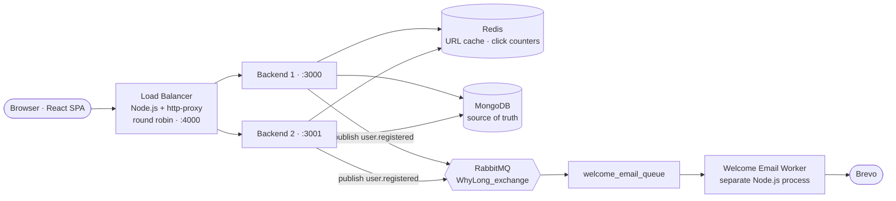
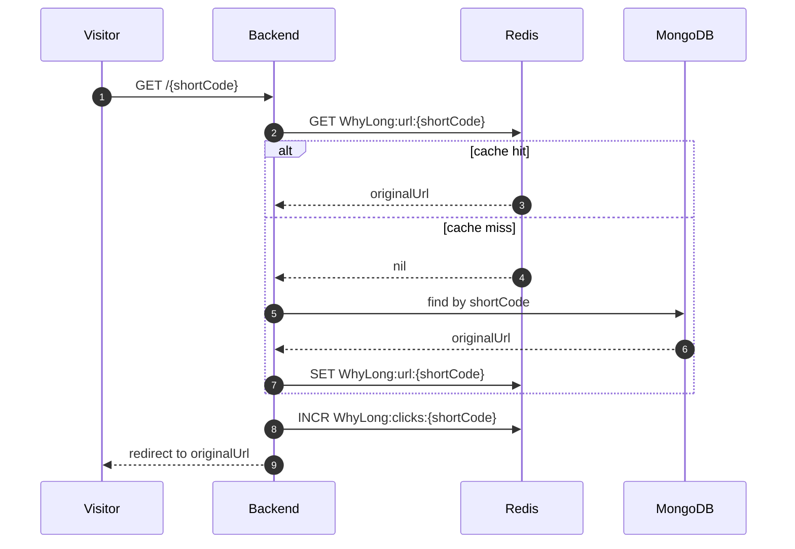
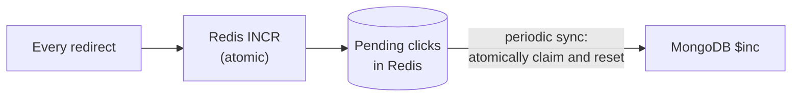
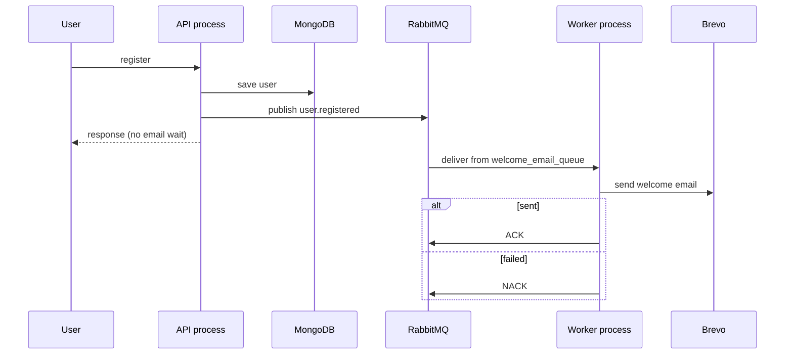
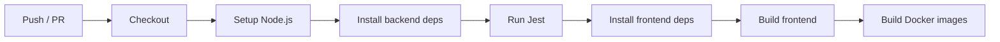

<div align="center">

# 🔗 WhyLong

**Whylong is a free URL shortener and link management platform to create short links, generate QR codes, and simplify link sharing. Built for easy, efficient, and accessible link management.**

Full-stack MERN application with Redis caching, atomic click counters, RabbitMQ background jobs, a load-balanced multi-instance backend, automated tests, Docker, and CI.

[](https://whylong.vercel.app)
[](https://github.com/devKartikeya/WhyLong)


</div>

---

## Contents

- [Overview](#overview)
- [Features](#features)
- [Architecture](#architecture)
- [Engineering Decisions](#engineering-decisions)
- [Deep Dives](#deep-dives) — [redirect path](#1-the-redirect-hot-path) · [click counting](#2-click-counting-without-a-write-per-click) · [async email](#3-asynchronous-work-with-rabbitmq) · [scaling out](#4-horizontal-scaling-behind-a-load-balancer)
- [Known Limitations](#known-limitations)
- [API Reference](#api-reference)
- [Getting Started](#getting-started)
- [Testing & CI](#testing--ci)
- [Project Structure](#project-structure)
- [Roadmap](#roadmap)

---

## Overview

WhyLong shortens URLs, generates customizable QR codes, and gives authenticated users a dashboard to manage their links and see how they perform. Anyone can shorten a link; signed-in users get ownership, management, and analytics.

It is also deliberately an **engineering project, not a CRUD demo.** Each infrastructure component was introduced in response to a concrete problem that appeared as the system grew:

| Problem observed | Component introduced | Cost accepted |
|:--|:--|:--|
| Hot links re-read from MongoDB on every redirect | Redis URL cache | Cache can serve stale data; invalidation becomes a concern |
| Every redirect still caused a MongoDB write (click count) | Redis atomic counters + periodic sync | Click counts are eventually consistent |
| Registration waited on the email provider | RabbitMQ + separate worker process | A broker and a worker to operate |
| One backend process is a capacity and availability limit | Load balancer + multiple backend instances | Shared state must live outside the processes; per-process state becomes a hazard |

> The intent is to be able to explain not just *what* each piece is, but *when it is the wrong choice*.

---

## Features

**URL shortening**
- Short, unique codes with collision checks; `http` and `https` URLs validated before anything is stored
- Duplicate detection on the **normalized** URL; the existing short code is reused when the same URL is shortened again
- Public shortening, plus authenticated shortening tied to the creating user

**QR codes**
- Generated from any short link, with configurable colors, sizes, and styles
- Brand identity via logos and text, error-correction handling for resilience, and saved presets

**Accounts & security**
- Registration and login with cookie-based JWT authentication; protected routes and resources
- Edit username and email, change password (current password required, new password confirmed), reset password via email verification, delete account behind a confirmation flow

**Dashboard & link management**
- Total links, total clicks, average clicks per link, links with and without clicks, best-performing link and its share of all clicks, recent links
- **My Links:** recent-first ordering, search and filtering, original URL and click counts at a glance
- Every number is computed from real data. No simulated analytics.

---

## Architecture



**Layering inside each backend instance:**

```text
Route → Authentication middleware → Controller → Service → Model → MongoDB
```

| Layer | Responsibility |
|:--|:--|
| **Route** | Declares endpoints and attaches middleware |
| **Controller** | Translates HTTP to a service call and back; contains no business rules |
| **Service** | Application and business logic |
| **Model** | Data structure and persistence via Mongoose |

**State placement is the central design rule:** MongoDB is the durable source of truth; Redis holds fast, derived, or temporary state; backend processes hold *nothing important*. That last property is what makes instances interchangeable.

---

## Engineering Decisions

| Decision | Why | Trade-off / when it is the wrong call |
|:--|:--|:--|
| **Cache resolved URLs in Redis** (`WhyLong:url:{shortCode}`) | Redirects dominate traffic and are almost pure reads; a cache hit avoids MongoDB entirely | Staleness. Fine while links are immutable; becomes a real invalidation problem once link editing ships. Low-traffic apps do not need a cache at all |
| **Count clicks with Redis `INCR`**, sync to MongoDB in batches | A cache hit still required a database write per click; atomic `INCR` is safe under concurrent requests | **Persistence is delayed.** Unsynced clicks live only in Redis. Wrong choice if every click must be durable immediately (billing, audit) |
| **Atomically claim pending clicks** during sync | Clicks arriving mid-sync accumulate separately and are persisted next cycle, with no double counting and no loss from the race | More moving parts than a direct `$inc` |
| **Application-level rate limiting** (Express middleware) | Simple, adequate for a single backend instance | Counters are per-process. See [limitations](#known-limitations) |
| **RabbitMQ + separate worker** for welcome email | Registration no longer waits on, or fails because of, an email provider; the API only publishes an event | Operating a broker, and *at-least-once* delivery means handlers should be idempotent |
| **Direct exchange + routing keys** | The API knows an event happened, not who handles it; new consumers bind without API changes | Topology to maintain and document |
| **JWT in cookies** | Authentication travels with the request, so no per-process session store is needed to scale out | Revocation is harder than with server-side sessions |
| **Own load balancer first** (`http-proxy`, round robin) | Learn the mechanics of distribution before adopting production infrastructure | Not production-grade: see limitations. A managed or battle-tested proxy (Nginx, HAProxy, a cloud LB) replaces it for real traffic |
| **Honest analytics** | Only aggregate clicks are stored, so only aggregate metrics are shown | No time series until click events are persisted |

---

## Deep Dives

### 1. The redirect hot path

Redirects are the highest-volume operation, so this path is optimized first.



On a hit, the request never touches MongoDB: no read for the URL and, as described next, no write for the click.

**Redis keys**

| Key | Value | Purpose |
|:--|:--|:--|
| `WhyLong:url:{shortCode}` | original URL | Read-through cache for redirects |
| `WhyLong:clicks:{shortCode}` | pending click count | Atomic counter awaiting synchronization |

### 2. Click counting without a write per click

The naive version issues a MongoDB `$inc` on every redirect, so a popular link produces a write for every visitor.



```text
MongoDB clicks = 500          Redis pending = 37
        │                              │
        │         sync: claim 37, reset to 0
        ▼                              ▼
MongoDB clicks = 537          Redis pending = 0   (new clicks start accumulating again)
```

> **Trade-off, stated plainly:** higher write throughput in exchange for temporarily delayed persistence. The dashboard reflects MongoDB, so it lags by up to one sync interval, and pending clicks are only as durable as Redis is.

### 3. Asynchronous work with RabbitMQ

The first real use case is the welcome email after registration. The request saves the user and publishes an event; it does not wait for the email provider.



- **Exchange:** direct exchange `WhyLong_exchange`, routing key `user.registered`, bound to `welcome_email_queue`.
- **Payload:** only what the worker needs (`userId`, `username`, `email`). **Passwords and other secrets are never published.**
- **Process model:** the worker lives in the same codebase but runs as its own process, so the API and worker scale and fail independently.

```text
Backend/
├── API process     →  node server.js
└── Worker process  →  node workers/welcome_email.worker.js
```

- **Acknowledgement:** a message is ACKed only after the email was actually sent, which gives at-least-once semantics and a base for retry and dead-letter handling.

### 4. Horizontal scaling behind a load balancer

The frontend talks to the load balancer rather than to any single backend, so instances can be added or removed without frontend changes.

```text
Before:  Frontend ──► Backend :3000
Now:     Frontend ──► Load Balancer :4000 ──► Backend :3000
                                          └─► Backend :3001
```

Round robin cycles through the instances (request 1 → backend 1, request 2 → backend 2, request 3 → backend 1, and so on).

**What makes instances interchangeable:**
- Authentication is JWT in cookies, so no in-process session store.
- Shared state lives in **Redis** (cache, counters) and **MongoDB** (durable data), outside any one process.

**What it exposes:** anything still held *inside* a process stops being shared the moment a second instance appears. The application-level rate limiter is exactly that case.

---

## Known Limitations

Documented deliberately: these are the current boundaries of the design, and most map directly to roadmap items.

| Area | Limitation | Planned direction |
|:--|:--|:--|
| **Rate limiting** | Counters live in each process. With round robin across *N* instances, a client can effectively receive up to *N×* the configured limit | Shared Redis-backed (distributed) limiter |
| **Click durability** | Clicks pending in Redis are not yet in MongoDB. Their survival depends on Redis persistence, and Redis failure handling is not yet implemented | Redis failure and fallback handling |
| **Load balancer** | Round robin only; no health checks, so an unhealthy instance keeps receiving traffic. The balancer itself is a single point of failure | Health checks, automatic instance removal, connection draining, or a production-grade proxy |
| **Email worker** | Failed messages are NACKed, but retry and dead-letter handling are not implemented yet | Retry with backoff and a dead-letter queue |

---

## API Reference

| Method | Endpoint | Auth | Description |
|:--|:--|:--:|:--|
| `POST` | `/urls/shorten` | No | Shorten a URL publicly |
| `POST` | `/urls/shorten/authenticated` | Yes | Shorten a URL owned by the signed-in user |
| `GET` | `/urls/my-links` | Yes | List the current user's links |
| `GET` | `/urls/delete/:shortCode` | Yes | Delete URL |
| `PATCH` | `/users/change-password` | Yes | Change password |
| `GET` | `/users/me` | No | Check whether user is logged in or not |
| `DELETE` | `/users/delete` | Yes | Delete a user |
| `GET` | `/:shortCode` | No | Resolve and redirect |

**Shorten**

```http
POST /urls/shorten
Content-Type: application/json

{ "originalUrl": "https://example.com/some/long/url" }
```

The URL is validated (`http` / `https` only) and normalized. If the normalized URL already exists, the existing short code is returned; otherwise a new code is generated, checked for collisions, and saved.

**Change password**

```http
PATCH /users/change-password

{ "oldPassword": "current", "newPassword": "new", "confirmPassword": "new" }
```

Authentication uses a JWT in an HTTP cookie, verified by middleware before any protected controller runs. Account deletion is available from the profile security settings behind a confirmation flow.

---

## Getting Started

### With Docker Compose

```bash
git clone https://github.com/devKartikeya/WhyLong.git
cd WhyLong
docker compose up --build
```

Compose builds and runs the frontend (multi-stage build served by Nginx) and the backend. MongoDB can remain externally hosted (for example MongoDB Atlas).

### Locally

**Prerequisites:** Node.js, a MongoDB connection string, and a running Redis (default `redis://localhost:6379`). RabbitMQ and Brevo credentials are needed for the welcome-email flow.

```bash
# Backend
cd Backend
npm install
```

Create `Backend/.env`:

```env
PORT=3000
MONGO_URI=your_mongo_uri
JWT_SECRET=your_jwt_secret
BREVO_API_KEY=your_brevo_key
SUPPORT_EMAIL=your@email.com
FRONTEND_URL=http://localhost:5173
RABBITMQ_URL=your@rabbitmq.url
REDIS_USERNAME=default
REDIS_PASSWORD=your_redis_password
REDIS_HOST=syour_redis_host
REDIS_PORT=16131
BACKEND_URL=http://localhost:3000
```

Redis, RabbitMQ, and Brevo settings are also read from the environment; see `Backend/configurations/` for the exact variables.

```bash
npm start                                  # API process

# in another terminal: background worker
node workers/welcome_email.worker.js

# in another terminal: frontend
cd Frontend && npm install && npm run dev
```

**Running multiple instances:** start a second backend on another port (for example `3001`), then run the Node.js `http-proxy` load balancer in front of both (`:4000`). The frontend's API base URL points at the load balancer, not at a backend.

---

## Testing & CI

**Tests:** Jest and Supertest.

```bash
cd Backend
npm test
```

The Express `app` is separated from the server bootstrap (`app.js` vs `server.js`), so Supertest can exercise routes in-process without binding a port or opening production connections.

**Continuous Integration (GitHub Actions)** runs on every push and pull request:



A change is considered healthy only if tests pass **and** the Docker images build. Deployment automation is intentionally separate from CI and is on the roadmap.

---

## Project Structure

```text
WhyLong/
├── Frontend/
│   ├── src/
│   │   ├── components/        # CreateLinkModal, LinkCard, EmptyLinks, ...
│   │   ├── pages/             # Home, Contact, ...
│   │   └── dashboard/         # Overview, Profile, ...
│   └── Dockerfile             # multi-stage: build with Node, serve with Nginx
│
├── Backend/
│   ├── configurations/        # database.js, redis.js
│   ├── urls/                  # route · controller · service · model
│   ├── users/                 # route · controller · service · model
│   ├── email/                 # route · controller · service
│   ├── middleware/            # authentication.middleware.js, ...
│   ├── workers/               # welcome_email.worker.js
│   ├── app.js                 # Express app (importable by tests)
│   ├── server.js              # process bootstrap
│   └── Dockerfile
│
├── docker-compose.yml
└── README.md
```

---

## Roadmap

**Shipped**
- [x] Shortening, validation, collision-safe code generation, duplicate detection and code reuse, redirects
- [x] QR generation with customization and presets
- [x] Auth (cookie + JWT), user-specific links, protected dashboard, password change/reset, account deletion
- [x] Dashboard statistics, My Links with search and filtering
- [x] Modular backend; Jest + Supertest tests
- [x] Redis URL cache, atomic click counters, periodic sync to MongoDB
- [x] Application-level rate limiting
- [x] Docker, Docker Compose, GitHub Actions CI
- [x] Local round-robin load balancer, frontend routed through it, multiple backend instances
- [x] RabbitMQ and an asynchronous welcome-email worker

**Planned** (ordered roughly by how much each reduces a [known limitation](#known-limitations))
- [ ] Distributed, Redis-backed rate limiting
- [ ] Redis failure and fallback handling
- [ ] Retry with backoff and dead-letter queue for email jobs
- [ ] Link editing, with an explicit cache-invalidation strategy
- [ ] Custom short aliases
- [ ] Persist click events, then daily/weekly/monthly analytics

> **On analytics:** once individual click events (timestamp, referrer, device, browser) are stored, time-series and traffic-source analytics become possible without fabricating data. Until then the dashboard shows only what the data supports.

---

<div align="center">

**WhyLong** is an educational and portfolio project. Feedback and suggestions are welcome via issues and pull requests.

</div>