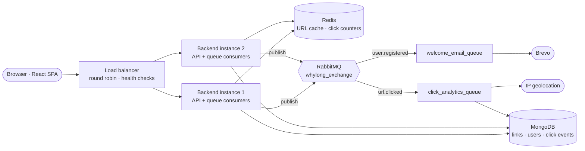
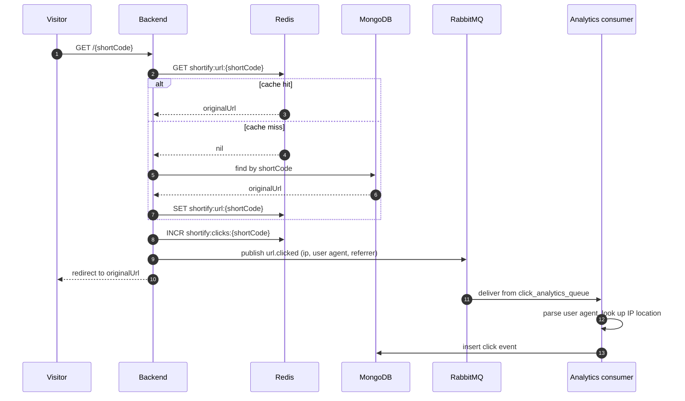
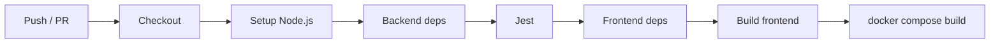

<div align="center">

# 🔗 WhyLong

**Short links, branded QR codes, and event-level click analytics in one free workspace.**

A full-stack MERN platform engineered around a cheap redirect hot path, queue-decoupled analytics, and stateless backend instances behind a health-checked load balancer.

[](https://whylong.vercel.app)
[](./ARCHITECTURE.md)
[](https://github.com/devKartikeya/WhyLong)


**Resources:** [WhyLong vs Bitly](https://whylong.vercel.app/blogs/whylong-vs-bitly) · [WhyLong vs TinyURL](https://whylong.vercel.app/blogs/whylong-vs-tinyurl) · [Blog](https://whylong.vercel.app/blogs) · [QR Code Generator](https://whylong.vercel.app/products/qr-code-generator)

</div>

---

## Contents

- [Overview](#overview)
- [Features](#features)
- [Architecture](#architecture)
- [Request Lifecycle](#request-lifecycle)
- [Engineering Decisions](#engineering-decisions)
- [Delivery Guarantees](#delivery-guarantees)
- [Security](#security)
- [Known Limitations](#known-limitations)
- [API Reference](#api-reference)
- [Getting Started](#getting-started)
- [Testing & CI](#testing--ci)
- [Project Structure](#project-structure)
- [Roadmap](#roadmap)

---

## Overview

WhyLong turns long URLs into short links, turns those links into branded QR codes, and shows how people interact with them. Anyone can shorten a link without an account. A free account unlocks the QR Studio, link management, and analytics. There are no paid tiers and no limits on links or QR codes.

| Capability | What it does |
|:--|:--|
| **URL shortener** | Collision-safe short codes, validation, and duplicate reuse. No account needed |
| **QR Studio** | Templates, logos, colors, gradients, dot and corner styles, brand text, PNG and SVG export |
| **Link analytics** | Click-level events with timestamps, device, browser, OS, location, and referrer |
| **Dashboard** | Overview graphs, **My Links** management, and per-link and per-QR analysis |

It is also deliberately an **engineering project, not a CRUD demo.** Four principles shaped it:

1. **Keep the hot path cheap.** Redirects are the highest-volume operation, so they avoid the database on a cache hit.
2. **Decouple slow work.** Email and click enrichment never block a user-facing request.
3. **Keep instances interchangeable.** Durable state lives in MongoDB, fast state in Redis, and processes hold nothing important.
4. **State the trade-offs.** Every component below lists what it costs and when it is the wrong choice.

| Problem observed | Component introduced | Cost accepted |
|:--|:--|:--|
| Hot links re-read from MongoDB on every redirect | Redis URL cache | Cached data can go stale; invalidation becomes a concern |
| Every redirect caused a MongoDB write for the click count | Redis atomic counters with periodic sync | Aggregate counts are eventually consistent |
| Registration waited on the email provider | RabbitMQ and a consumer | A broker to operate; at-least-once handling needs idempotence |
| Geo and user-agent enrichment would slow redirects | Click events published to a queue | Event delivery guarantees must be designed (see below) |
| One backend process limits capacity and availability | Health-checked load balancer, multiple instances | Per-process state becomes a hazard |

---

## Features

### URL Shortening

- Short, unique codes with collision checks; only `http` and `https` URLs are accepted
- Duplicate detection on the **normalized** URL; the existing short code is reused
- Public shortening, plus authenticated shortening tied to the creating user
- Redirects resolve from a Redis cache before touching MongoDB

### QR Studio

| Area | Options |
|:--|:--|
| **Templates** | Classic, Midnight, Sunrise, Ocean, Violet |
| **Colors** | QR color, background, corner color, optional two-color gradient |
| **Patterns** | Six dot styles, three corner-frame styles, three inner-dot styles |
| **Logo** | PNG, JPG, WebP, or SVG up to 2 MB; adjustable size |
| **Brand text** | Brand name (40 characters) and call to action (60 characters) rendered under the code |
| **Reliability** | Error correction L / M / Q / H and an adjustable quiet-zone margin |
| **Export** | PNG at 256, 512, or 1024 px; SVG for print |
| **Presets** | Save and reload brand designs (stored in the browser) |

### Link Analytics

Every redirect produces an event that is enriched asynchronously and stored for analysis.

| Dimension | Captured |
|:--|:--|
| **Time** | Timestamp of each click, plotted as graphs and history |
| **Device** | Device type, operating system, browser |
| **Location** | Country, region, city (IP-based) |
| **Source** | Referrer, when the browser provides one |
| **Totals** | Total clicks and CTR |

Some fields depend on browser-supplied metadata or IP geolocation, so they can be missing or approximate for individual clicks.

### Dashboard & Link Management

- **Overview:** total links, total clicks, average clicks per link, best-performing link, recent links, and timestamped graphs
- **My Links:** recent-first ordering, search and filtering, copy, delete, and deeper analysis per link or QR
- **Analytics:** a dedicated view for click and scan analysis
- Every number is computed from real data

### Accounts

- Registration, login, logout, profile editing, password change, and password reset by email
- Cookie-based JWT authentication with protected routes and resources
- Account deletion behind a confirmation flow

---

## Architecture



**Layering inside each backend instance:** `Route → Middleware → Controller → Service → Model → MongoDB`

**State placement is the central rule.** MongoDB is the durable source of truth, Redis holds fast and derived state, and backend processes hold nothing important. That is what makes instances interchangeable.

> Sequence diagrams, schemas, and the full reasoning live in **[ARCHITECTURE.md](./ARCHITECTURE.md)**.

---

## Request Lifecycle

The redirect is the highest-volume operation. Its response never waits on analytics work.



Two separate data paths serve different needs:

| Path | Purpose | Freshness |
|:--|:--|:--|
| **Aggregate counter** (Redis `INCR`, flushed to MongoDB every 60 s) | Cheap, always-available click totals | Lags by up to one sync interval |
| **Click events** (queue, enrich, insert) | Timestamped, per-dimension analytics | Asynchronous; depends on consumer throughput |

**Counter sync, atomically.** Pending clicks are claimed and reset in one step, so clicks that arrive mid-sync accumulate separately and are persisted next cycle, with no double counting and no loss from the race.

```text
MongoDB clicks = 500          Redis pending = 37
        │                              │
        │         sync: claim 37, reset to 0
        ▼                              ▼
MongoDB clicks = 537          Redis pending = 0   (new clicks start accumulating again)
```

---

## Engineering Decisions

| Decision | Why | Trade-off / when it is the wrong call |
|:--|:--|:--|
| **Read-through Redis URL cache** (`shortify:url:{code}`) | Redirects are almost pure reads; a hit skips MongoDB entirely | Staleness. Fine while links are immutable; link editing will need an explicit invalidation strategy |
| **Redis `INCR` plus batched sync** (60 s) | Avoids a database write per click; `INCR` is atomic under concurrency | Persistence is delayed, and unsynced increments are only as durable as Redis. Wrong for billing or audit counts |
| **Atomic claim during sync** | No double counting and no loss when clicks arrive mid-sync | More moving parts than a direct `$inc` |
| **Click events through RabbitMQ** | Geo and user-agent enrichment stay off the redirect path; `prefetch(1)` applies backpressure to the database | Delivery semantics must be designed (see below); the lookup depends on an external geolocation service |
| **Direct exchange and routing keys** (`user.registered`, `url.clicked`) | The API publishes that something happened, not who handles it; new consumers bind without API changes | Topology to maintain and document |
| **Durable queues** | Messages survive a broker restart | Throughput cost; consumers still need idempotence |
| **JWT in cookies** | Authentication travels with the request, so no per-process session store is needed to scale out | Revocation is harder than with server-side sessions |
| **Own load balancer first** (`http-proxy`, round robin, health checks every 5 s) | Learn distribution mechanics before adopting managed infrastructure | A single instance is a single point of failure; production traffic belongs on Nginx, HAProxy, or a cloud LB |
| **Honest analytics** | Only stored data is shown, and missing fields stay missing | No inferred or simulated metrics |

---

## Delivery Guarantees

What each flow actually promises today, including the gaps.

| Flow | Mechanism | Guarantee today | Gap |
|:--|:--|:--|:--|
| **Redirect** | Redis cache, falling back to MongoDB | Correct while links are immutable | No fallback if Redis is unavailable |
| **Aggregate clicks** | Redis `INCR`, atomic claim, 60 s sync | Eventually consistent | Pending increments depend on Redis durability |
| **Click events** | `url.clicked` → durable queue → consumer | Off the redirect path; events are enriched and stored | Acknowledged in a `finally` block, so a failed event is dropped (at-most-once); no retry or dead-letter queue |
| **Welcome email** | `user.registered` → durable queue → consumer → Brevo | Acknowledged only after a successful send | A failed message is rejected without requeue; no retry or dead-letter queue yet |

---

## Security

**In place**

- Cookie-based JWT authentication; protected routes verified by middleware before any controller runs
- Passwords hashed with bcrypt; password reset through an emailed token
- Helmet security headers and a CORS allow-list with credentials
- Request rate limiting at both the API and the load balancer
- URL validation and normalization before anything is stored
- Secrets read from environment variables; messages published to the broker carry only the fields a consumer needs, never passwords

**Practices**

- Keep `.env` files out of version control, and rotate any credential that has ever been committed
- Report security issues privately through GitHub rather than in a public issue

---

## Known Limitations

Documented deliberately. These are the current boundaries of the design, and most map to roadmap items.

| Area | Limitation | Planned direction |
|:--|:--|:--|
| **Rate limiting** | Counters live in each process (API and load balancer each keep their own), so effective limits depend on where a request is counted | Shared, Redis-backed limiter |
| **Redis dependency** | No fallback path when Redis is down; pending counters are at risk | Failure handling and graceful degradation |
| **Event delivery** | Click events are at-most-once, and neither queue has retry with backoff or a dead-letter queue | Explicit retry policy and dead-letter queues |
| **Process model** | Each backend instance runs the API and both consumers from one entry point, so they cannot scale independently yet | Split consumers into standalone processes |
| **Analytics read path** | Per-link analytics are returned with the link list and aggregated on the client, which is fine at current scale but not for very high-volume links | Server-side aggregation, pagination, and date-range queries |
| **Analytics completeness** | Referrers can be absent, and IP geolocation is approximate | Clearer field-level availability in the UI |
| **Load balancer** | Round robin with active health checks, but it is a single instance with no connection draining or weighting | Redundant balancers or a managed proxy |
| **Links** | Short links are immutable; there is no editing yet | Link editing with cache invalidation |

---

## API Reference

All routes are served by the backend. Protected routes expect the authentication cookie.

**Links** · prefix `/urls`

| Method | Endpoint | Auth | Description |
|:--|:--|:--:|:--|
| `POST` | `/urls/shorten` | No | Shorten a URL publicly |
| `POST` | `/urls/shorten/authenticated` | Yes | Shorten a URL owned by the signed-in user |
| `GET` | `/urls/my-links` | Yes | The current user's links, with click data |
| `GET` | `/urls/delete/:shortCode` | Yes | Delete a link |

**Users** · prefix `/users`

| Method | Endpoint | Auth | Description |
|:--|:--|:--:|:--|
| `POST` | `/users/register` | No | Create an account (publishes `user.registered`) |
| `POST` | `/users/login` | No | Sign in and set the authentication cookie |
| `GET` | `/users/me` | Yes | Current user; used to check whether a session is active |
| `PATCH` | `/users/profile` | Yes | Update username and email |
| `PATCH` | `/users/change-password` | Yes | Change password |
| `POST` | `/users/forgot-password` | No | Send a password-reset email |
| `PATCH` | `/users/reset-password` | No | Reset the password with a token |
| `POST` | `/users/logout` | Yes | Sign out |
| `DELETE` | `/users/delete` | Yes | Delete the account |

**Other**

| Method | Endpoint | Auth | Description |
|:--|:--|:--:|:--|
| `POST` | `/email/contact` | No | Send a contact message |
| `GET` | `/health` | No | Health probe used by the load balancer |
| `GET` | `/:shortCode` | No | Resolve and redirect |

**Shorten**

```http
POST /urls/shorten
Content-Type: application/json

{ "originalUrl": "https://example.com/some/long/url" }
```

The URL is validated (`http` and `https` only) and normalized. If the normalized URL already exists, the existing short code is returned. Otherwise a new code is generated, checked for collisions, and saved.

**Change password**

```http
PATCH /users/change-password

{ "oldPassword": "current", "newPassword": "new", "confirmPassword": "new" }
```

---

## Getting Started

### With Docker Compose

```bash
git clone https://github.com/devKartikeya/WhyLong.git
cd WhyLong
docker compose up --build
```

Compose starts the frontend (multi-stage build served by Nginx), the load balancer, **two backend instances**, Redis, and RabbitMQ. MongoDB stays external (for example MongoDB Atlas). See `docker-compose.yml` for the exposed ports.

### Locally

**Prerequisites:** a current Node.js LTS, a MongoDB connection string, and a running Redis. RabbitMQ is needed for click analytics and the welcome email, and a Brevo key for sending mail.

**1. Backend**

```bash
cd Backend
npm install
```

Create `Backend/.env` (never commit it):

```env
PORT=3000
MONGO_URI=your_mongo_uri
JWT_SECRET=your_jwt_secret
FRONTEND_URL=http://localhost:5173
BACKEND_URL=http://localhost:3000
RABBITMQ_URL=your_rabbitmq_url
BREVO_API_KEY=your_brevo_key
SUPPORT_EMAIL=you@example.com

# Redis: either a single URL...
REDIS_URL=redis://localhost:6379
# ...or discrete settings
# REDIS_HOST=your_redis_host
# REDIS_PORT=your_redis_port
# REDIS_USERNAME=default
# REDIS_PASSWORD=your_redis_password
```

```bash
npm start      # starts the API and both queue consumers
```

**2. Frontend**

Create `Frontend/.env`:

```env
VITE_API_URL=http://localhost:3000
```

```bash
cd Frontend
npm install
npm run dev
```

**Running behind the load balancer:** start two backend instances on different ports, run the load balancer in front of them (it listens on `:4000`), and point `VITE_API_URL` at the balancer. Or simply use Docker Compose, which wires this up.

---

## Testing & CI

**Tests:** Jest and Supertest.

```bash
cd Backend
npm test
```

The Express `app` is separated from the process bootstrap (`app.js` vs `server.js`), so Supertest can exercise routes in-process without binding a port or opening production connections.

**Continuous Integration (GitHub Actions)** runs on every push and pull request:



A change is healthy only if tests pass **and** the Docker images build. Deployment automation is intentionally separate from CI.

---

## Project Structure

```text
WhyLong/
├── Frontend/                     # React + Vite + Tailwind
│   └── src/
│       ├── components/           # Auth, Home, Tutorials, ui
│       ├── pages/                # products, blogs, Tutorials, legal, ...
│       ├── dashboard/            # Overview, My Links, QR Studio, Analytics, Profile
│       ├── content/              # blog and tutorial content
│       ├── context/              # shared state (auth)
│       └── routes/               # protected and public layouts
│
├── Backend/
│   ├── urls/                     # route · controller · service · model
│   ├── users/                    # route · controller · service · model
│   ├── clicks/                   # click-event model, counter sync
│   ├── email/                    # contact route and mail service
│   ├── workers/                  # welcome_email, click_analytics consumers
│   ├── middleware/               # authentication, request linting
│   ├── configurations/           # database, redis, rabbitmq, cors, helmet, rate-limiter, user-agent
│   ├── utilities/                # jwt, geo-location, reset tokens, log cleanup
│   ├── tests/
│   ├── app.js                    # Express app (importable by tests)
│   ├── server.js                 # HTTP server and periodic jobs
│   └── index.js                  # entry point: server and consumers
│
├── LoadBalancer/                 # http-proxy, round robin, health checks
├── .github/workflows/ci.yml
├── docker-compose.yml
├── ARCHITECTURE.md
└── README.md
```

---

## Roadmap

**Shipped**

- [x] Shortening, validation, collision-safe codes, duplicate reuse, redirects
- [x] QR Studio: templates, logos, colors, gradients, patterns, brand text, presets, PNG and SVG export
- [x] Auth, user-specific links, protected dashboard, password change and reset, account deletion
- [x] Dashboard overview, My Links, and a dedicated analytics view
- [x] Event-level analytics: timestamps, device, browser, OS, location, referrer
- [x] Redis URL cache, atomic click counters, periodic sync
- [x] RabbitMQ pipelines for welcome email and click analytics
- [x] Rate limiting, Helmet, and a CORS allow-list
- [x] Load balancer with health checks, and multiple backend instances
- [x] Docker, Docker Compose, GitHub Actions CI, Jest and Supertest tests
- [x] Public product, tutorial, and blog pages

**Planned** (ordered roughly by how much each reduces a [known limitation](#known-limitations))

- [ ] Retry with backoff and dead-letter queues for both consumers
- [ ] Redis failure handling and graceful degradation
- [ ] Distributed, Redis-backed rate limiting
- [ ] Server-side analytics aggregation, pagination, and date-range comparisons
- [ ] Standalone, independently scalable consumer processes
- [ ] Link editing, with an explicit cache-invalidation strategy
- [ ] Custom short aliases

---

<div align="center">

[Privacy Policy](https://whylong.vercel.app/legal/privacy-policy) · [Terms and Conditions](https://whylong.vercel.app/legal/terms-and-conditions) · [Cookie Policy](https://whylong.vercel.app/legal/cookie-policy)

**© 2026 WhyLong** · An educational and portfolio project. Feedback is welcome through issues and pull requests.

</div>
